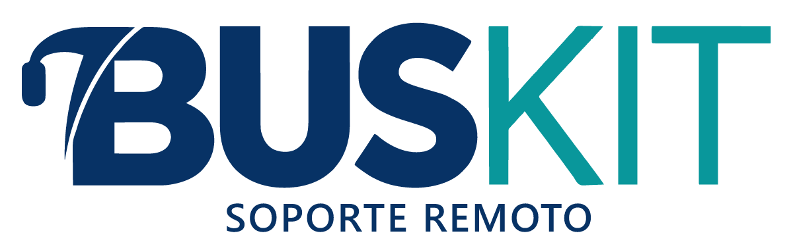

# BUSKIT Soporte Remoto

Soporte remoto para clientes Windows, basado en **RustDesk OSS 1.5.0**, con servidor propio de BUSKIT y sin licencia Pro.

[Descargar MSI](https://sdm.cl/empresas/BUSKIT/soporte-remoto/BUSKIT-Soporte-Remoto.msi) · [Descargar EXE](https://sdm.cl/empresas/BUSKIT/soporte-remoto/BUSKIT-Soporte-Remoto.exe) · [GitHub Releases](https://github.com/sdmcl/buskit-soporte-remoto/releases) · [Guía Windows y acceso desatendido](buskit/GUIA-WINDOWS.md) · [Compilación](buskit/BUILD.md) · [Privacidad](buskit/PRIVACIDAD.md)

Los instaladores se alojan en el mismo hosting de distribución de agencias, en una carpeta propia. Consulta [publicación y mantenimiento de descargas](buskit/hosting/README.md).

## Qué incluye

- Nombre, logo, iconos y colores BUSKIT.
- Servidor de identificación/relay y clave pública incorporados.
- Interfaz inicialmente en español.
- Soporte con autorización presencial o contraseña permanente configurada localmente.
- Varias sesiones desde el mismo equipo del técnico.
- EXE portátil y MSI x64 mediante GitHub Actions.
- Instalador MSI en español con logo BUSKIT y ruta fija `C:\BusKIT\Soporte`.
- Configuración y servicio propios, separados del RustDesk original.
- Código fuente público, licencia AGPL-3.0 y atribuciones preservadas.

No se incluyen cuentas centrales, agenda sincronizada ni consola Pro. Las contraseñas de acceso desatendido se establecen en cada PC; no existe una contraseña maestra en el instalador o repositorio. Las actualizaciones se publican manualmente en Releases.

## Estado inicial

El servidor RustDesk OSS está operativo. La compilación personalizada debe pasar las verificaciones descritas en [BUILD.md](buskit/BUILD.md) antes de ofrecer una versión estable. La primera sesión real entre dos equipos y el ensayo del servicio desatendido requieren un segundo Windows de prueba.

## Licencia y procedencia

Derivado de [rustdesk/rustdesk](https://github.com/rustdesk/rustdesk), tag `1.5.0`. Consulta [LICENCE](LICENCE), [aviso de distribución](buskit/LICENSE-NOTICE.txt) y [README original](README.upstream.md). Las marcas conservan sus respectivos titulares.
